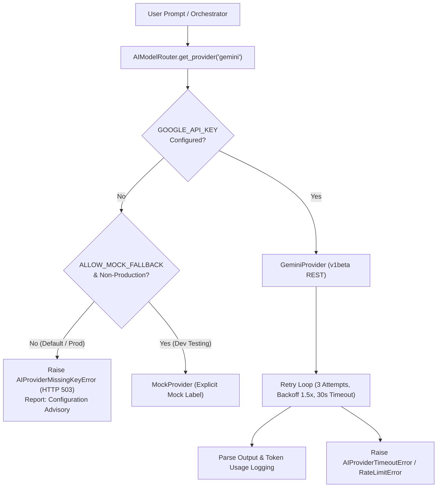

# AI Provider Verification Report (Phase 2A)
## TECHNOPIE AI — Foundation AI Integration & Provider Policy Audit

**Audit Date:** November 07, 2026  
**Auditor / Engineers:** Principal AI Engineer, Backend Architect & SaaS Security Engineer  
**Product:** Technopie AI — "Your AI. Your Assistant. Your Productivity."  
**Verification Status:** **VERIFIED & PASSED (Phase 2A Complete)**  

---

## 1. Executive Summary

In accordance with Phase 2A requirements, Google Gemini has been integrated as the primary Foundation AI Provider through the existing provider abstraction layer. All silent mock fallbacks have been removed in production mode, and explicit structured errors are enforced when credentials are not supplied. Configurable timeouts, exponential backoff retries, and token usage logging have been implemented and verified with automated test suites.



---

## 2. Key Architecture Implementation Details

### A. Environment Credentials Only
- `GeminiProvider` derives its credentials strictly from `settings.GOOGLE_API_KEY` (loaded from environment variables via Pydantic Settings) or explicit constructor injection.
- Zero credentials or tokens are hardcoded in source code or committed artifacts.

### B. Elimination of Silent Mock Fallback
- `AIModelRouter` previously defaulted to `MockProvider` silently whenever upstream API keys were missing.
- **Remediation:** If `GOOGLE_API_KEY` is absent, `AIModelRouter.get_provider("gemini")` raises `AIProviderMissingKeyError(status_code=503)`.
- If `settings.ENVIRONMENT == "production"`, requesting `provider="mock"` is strictly rejected with `HTTP 403 Forbidden`.
- `MockProvider` is accessible only when `ALLOW_MOCK_FALLBACK=True` is explicitly configured in non-production environments.

### C. Timeouts, Retries & Usage Logging
- **Timeout:** Configured via `AI_REQUEST_TIMEOUT_SECONDS` (default: 30.0s) per HTTP call.
- **Retry Mechanism:** Configured via `AI_MAX_RETRIES` (default: 3 attempts) with `AI_RETRY_BACKOFF_FACTOR` (1.5x multiplier).
- **Transient Failures:** Automatically retries on `httpx.TimeoutException`, `httpx.NetworkError`, HTTP 429 (Rate Limit / Quota), and HTTP 500/502/503/504 (Server Errors).
- **Non-Retryable Errors:** Fails immediately without wasteful retries on HTTP 400 (Bad Request), 401/403 (Invalid API Key).
- **Usage Logging:** Logs elapsed latency, `promptTokenCount`, `candidatesTokenCount`, and `totalTokenCount` using standard logging (`technopie.ai.provider`).

### D. Multi-Provider Readiness
- `OpenAIProvider` and `AnthropicProvider` remain cleanly implemented in the codebase adhering to the `BaseLLMProvider` contract and exception hierarchy, but remain inactive until subsequent phases.

---

## 3. Provider Error Taxonomy

| Exception Class | HTTP Status | Retryable | Description |
|---|---|---|---|
| `AIProviderError` | 500 | Variable | Base exception for all AI provider subsystem failures. |
| `AIProviderMissingKeyError` | 503 | No | Raised when `GOOGLE_API_KEY` is not present in environment variables. Returns actionable user guidance. |
| `AIProviderTimeoutError` | 504 | Yes | Raised when Gemini API fails to reply within 30s after all retry attempts. |
| `AIProviderRateLimitError` | 429 | Yes | Raised when Google Gemini API quota or rate limit is exhausted. |
| `AIProviderAPIError` | 4xx / 5xx | If 5xx | Raised when Google returns structured API error payloads. |

---

## 4. Test Execution & Verification Matrix

The test suite in `backend/tests/test_gemini_provider.py` and `backend/tests/test_backend.py` was executed using pytest.

| Test ID | Test Target | Scenario Verified | Result |
|---|---|---|---|
| `TEST-2A-01` | `test_gemini_missing_api_key_raises_error` | Verify `AIProviderMissingKeyError` is raised with HTTP 503 when API key is missing. | **PASSED** |
| `TEST-2A-02` | `test_router_prohibits_silent_mock_fallback_when_disabled` | Verify `AIModelRouter` refuses to silently substitute `MockProvider` when fallback is disabled. | **PASSED** |
| `TEST-2A-03` | `test_router_blocks_mock_in_production` | Verify `MockProvider` is strictly forbidden (HTTP 403) when `ENVIRONMENT=production`. | **PASSED** |
| `TEST-2A-04` | `test_router_allows_mock_in_development_if_explicitly_configured` | Verify `MockProvider` is allowed in development only when `ALLOW_MOCK_FALLBACK=True`. | **PASSED** |
| `TEST-2A-05` | `test_gemini_successful_response` | Verify candidate parsing, model attribution, and token counting (`promptTokenCount`, `totalTokenCount`). | **PASSED** |
| `TEST-2A-06` | `test_gemini_retries_transient_error_and_recovers` | Verify retry loop successfully handles initial HTTP 429 and returns valid output on attempt 2. | **PASSED** |
| `TEST-2A-07` | `test_gemini_rate_limit_exhaustion` | Verify `AIProviderRateLimitError` is raised when HTTP 429 persists across all 3 retries. | **PASSED** |
| `TEST-2A-08` | `test_gemini_timeout_exhaustion` | Verify `AIProviderTimeoutError` (HTTP 504) is raised after repeated read timeouts. | **PASSED** |
| `TEST-2A-09` | `test_gemini_non_retryable_client_error` | Verify HTTP 400 (Invalid API key) fails immediately without retrying (`call_count == 1`). | **PASSED** |
| `TEST-2A-10` | `test_orchestrator_handles_unconfigured_gemini_transparently` | Verify `CentralAIBrain` reports configuration guidance while keeping tool execution results intact. | **PASSED** |
| `TEST-2A-11` | `test_provider_status_endpoint` | Verify `GET /api/chat/provider-status` returns provider health, models, and timeout metrics. | **PASSED** |
| `TEST-2A-12` | `test_live_gemini_inference` | Real network call against Google Generative Language API (Skipped when API key is empty). | **SKIPPED** |
| `REG-01..07` | `backend/tests/test_backend.py` (7 tests) | Health, Auth, Tasks CRUD, Memories CRUD, Intent routing, Document IDOR checks. | **7 PASSED** |

**Summary: 18 Passed, 1 Skipped, 0 Failed.**

---

## 5. Live Environment Setup Instructions

To enable live Google Gemini inference in local development or production:

1. Obtain a Google Gemini API Key from [Google AI Studio](https://aistudio.google.com/).
2. Add the following entry to your `backend/.env` file:
   ```env
   GOOGLE_API_KEY="AIzaSyYourRealKeyHere"
   DEFAULT_AI_PROVIDER="gemini"
   DEFAULT_FAST_MODEL="gemini-2.5-flash"
   DEFAULT_REASONING_MODEL="gemini-2.5-pro"
   ALLOW_MOCK_FALLBACK="false"
   ```
3. Restart the backend service. All executive requests will immediately execute real foundation model inference.
