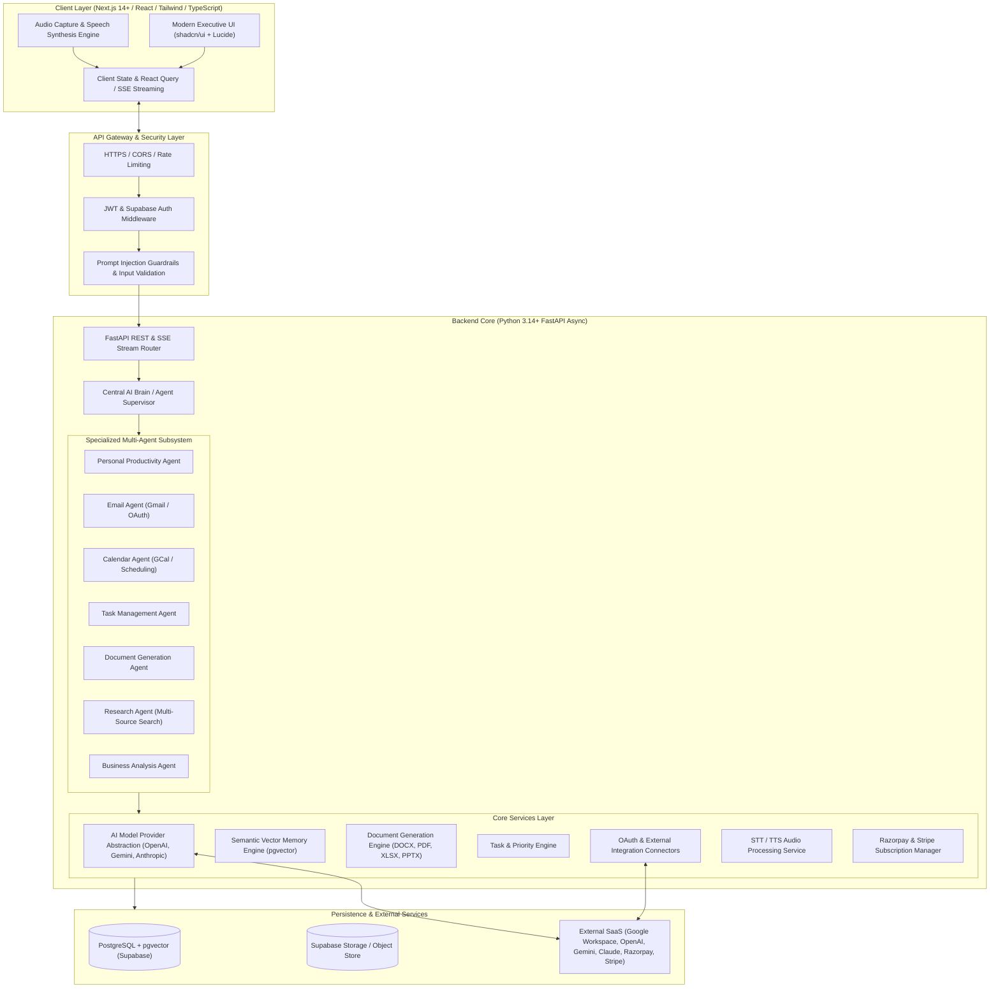

# System Architecture Document
## TECHNOPIE AI — Enterprise Multi-Agent Architecture

**Architecture Status:** Approved for Implementation  
**Target Platform:** Web SaaS (Responsive Mobile/Desktop), Microservices-ready Modular Monolith  

---

## 1. High-Level Architecture Diagram



---

## 2. Component Breakdown

### 2.1 Frontend Architecture (`/frontend`)
- **Framework:** Next.js (App Router), React, TypeScript.
- **Styling & Components:** Tailwind CSS, custom shadcn/ui components (Radix primitives), Lucide React icons.
- **Theme System:** Dark Navy executive palette (`#070B14`, `#0F172A`, `#1E293B`, subtle executive blue `#3B82F6` and cyan `#06B6D4` accents) with seamless Light theme toggle.
- **Core Views:**
  - `/` (Executive Dashboard & Active Conversation Workspace)
  - `/assistant` (Full-screen dedicated AI Executive Assistant Chat)
  - `/tasks` (Multi-view Task & Priority Board: Today, Upcoming, Overdue, All)
  - `/calendar` (Schedule Optimizer, Meeting Agendas, Free/Busy views)
  - `/emails` (Categorized Inbox, Action items, Draft approvals)
  - `/documents` (Generated business proposals, reports, spreadsheets, slides)
  - `/research` (Deep research syntheses, fact vs. opinion breakdowns)
  - `/memory` (User-controlled memory inspection, edits, and privacy toggles)
  - `/automations` (Trigger & action workflows, audit histories)
  - `/integrations` (Connected Apps status, Google OAuth consent)
  - `/billing` (Subscription tiers, Razorpay/Stripe checkout, usage meters)
  - `/admin` (Platform telemetry, API cost metrics, user management)
  - `/onboarding` (Guided multi-step executive setup)
- **Real-Time Communication:** Server-Sent Events (SSE) for streaming AI token outputs, real-time tool execution progress, and async task notifications.

### 2.2 Backend Architecture (`/backend`)
- **Runtime:** Python 3.14+, FastAPI async architecture, Uvicorn ASGI server.
- **Architecture Pattern:** Clean Layered Architecture:
  - `api/`: REST & SSE endpoints, route handlers, request validation models.
  - `core/`: Config settings, security utilities, database session manager, logging.
  - `agents/`: LangGraph-style agent graph definitions, state schemas, tool definitions, autonomy safeguards.
  - `services/`: Business logic services (AI Model Router, Memory Service, Task Service, Integration Service, Document Service, Research Service, Voice Service).
  - `models/`: SQLAlchemy ORM models & Pydantic domain schemas.
  - `db/`: Database migrations, seed scripts, vector index setup.

### 2.3 Central AI Brain & Agent Orchestration
The Central Orchestrator functions as a **Supervisor Agent** that decomposes user intent into directed graph sub-tasks:
1. **Intent Resolution & Context Assembly:** Merges immediate message context with user persona, working habits, and semantic vector memories.
2. **Agent Delegation:** Routes specialized queries:
   - Calendar or meeting conflicts $\rightarrow$ `Calendar Agent`
   - Email summaries or drafting $\rightarrow$ `Email Agent`
   - File creation $\rightarrow$ `Document Agent`
   - Market data or competitor info $\rightarrow$ `Research Agent`
   - Task planning $\rightarrow$ `Task Management Agent`
3. **Autonomy Guardrail Evaluation:**
   - **Level 1 (Read):** Auto-executed without prompting (e.g. reading schedule, fetching emails).
   - **Level 2 (Prepare):** Auto-created as proposals (e.g. drafting an email reply, assembling a task list).
   - **Level 3 (Execute):** Blocked until explicit user confirmation (e.g. sending emails, deleting data, external booking).
4. **Verification & Structured Output:** Validates tool returns, checks constraints, and returns standard payload schemas to the frontend.

### 2.4 AI Model Provider Abstraction Layer
A unified interface `BaseLLMProvider` with dynamic routing:

```
                  ┌──────────────────────┐
                  │    AI Model Router   │
                  └──────────┬───────────┘
                             │
         ┌───────────────────┼───────────────────┐
         ▼                   ▼                   ▼
┌─────────────────┐ ┌─────────────────┐ ┌─────────────────┐
│ OpenAI Provider │ │ Gemini Provider │ │Anthropic Provider│
│ (GPT-4o / mini) │ │(2.5 Pro / Flash)│ │(Claude 3.5 S/H) │
└─────────────────┘ └─────────────────┘ └─────────────────┘
         ▲                   ▲                   ▲
         └───────────────────┴───────────────────┘
                             │ Fallback Cascade
                    ┌─────────────────┐
                    │  Mock / Offline │
                    │ Provider Engine │
                    └─────────────────┘
```

- **Task-Based Routing Matrix:**
  - *Fast conversational / Simple intent:* `Gemini 2.5 Flash` or `GPT-4o-mini` (economical, low latency).
  - *Complex reasoning & multi-step planning:* `Claude 3.5 Sonnet` or `GPT-4o` (high precision).
  - *Large context document analysis & research:* `Gemini 2.5 Pro` (2M+ token context window).
- **Graceful Fallback:** If an API key is missing or encounters a rate limit (HTTP 429), the router seamlessly cascades to available providers or returns informative guidance with local mock execution.

### 2.5 Personal Memory System (pgvector)
- **Hierarchical Memory Model:**
  - *Short-Term Working Memory:* Active thread session cache.
  - *Semantic Episodic Memory:* Stored message highlights, facts, and events embedded using vector models (e.g. `text-embedding-3-small` or local semantic embedding).
  - *Declarative Profile Memory:* Structured key-value user preferences (e.g., "Prefers morning meetings between 9 AM and 11 AM", "Tone: Concise & Executive").
- **Privacy & Governance:** User-partitioned tenant IDs. The user can view, edit, search, export, or permanently delete any memory entity at any time.

### 2.6 Document Generation Pipeline
Native generation engines with real byte-level outputs:
- **DOCX:** `python-docx` for styled corporate memos, proposals, and briefs with headers, tables, and callouts.
- **PDF:** `reportlab` for pixel-perfect executive PDF reports and invoices.
- **XLSX / CSV:** `openpyxl` & standard CSV for financial projections, task exports, and data tables.
- **PPTX:** `python-pptx` for multi-slide executive presentation decks.
- Files are saved with unique SHA-256 content hashes in secure storage and served via signed download endpoints.

### 2.7 Security & Isolation
- **Authentication:** Standard JWT Bearer tokens, Supabase Auth integration, and Google OAuth 2.0.
- **Token Encryption:** Refresh tokens and OAuth credentials for Gmail/GCal are encrypted at rest using AES-256-GCM before database insertion.
- **Prompt Injection Defense:** External data is enclosed in untrusted tags and processed with instruction-disarming system prompts.
