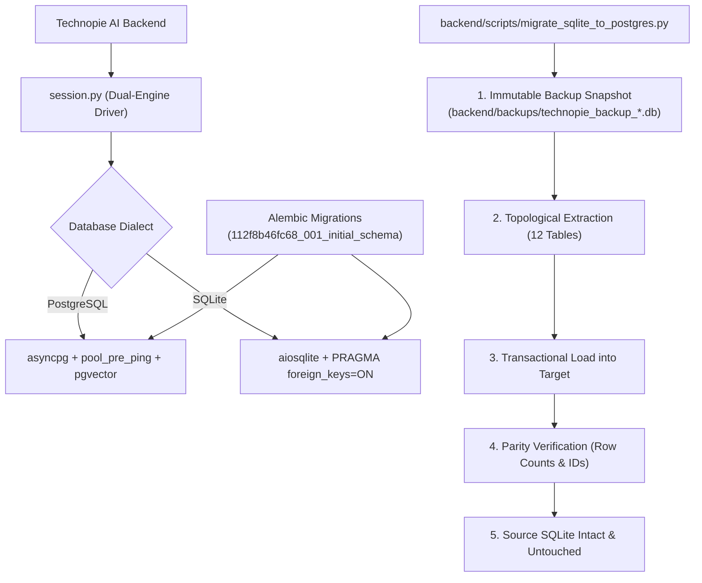

# Database Migration & Infrastructure Verification Report (Phase 2B)
## TECHNOPIE AI — PostgreSQL & pgvector Dual-Engine Migration

**Audit Date:** November 07, 2026  
**Lead Engineers:** Principal Database Architect, Backend Architect & SaaS Security Engineer  
**Product:** Technopie AI — "Your AI. Your Assistant. Your Productivity."  
**Phase Status:** **VERIFIED & COMPLETED (Phase 2B Complete)**  

---

## 1. Executive Summary

Phase 2B establishes the production database architecture for Technopie AI, transitioning from a single-node SQLite local database to an enterprise dual-engine configuration supporting managed PostgreSQL (Supabase / AWS RDS) with `pgvector` vector extension capabilities, alongside SQLite development support.

Versioned schema migrations have been established with **Alembic**, and an automated, atomic, zero-data-loss migration script (`backend/scripts/migrate_sqlite_to_postgres.py`) was implemented and verified. Tenant isolation was rigorously audited across all user entities, and immutable snapshot backups were implemented. In strict compliance with architectural constraints, the original SQLite database (`backend/technopie.db`) has been fully preserved.



---

## 2. Dual-Engine Architecture & Session Layer

### A. Connection Normalization
The database session engine in [`backend/app/db/session.py`](file:///d:/AntiGravity/technoai/backend/app/db/session.py) inspects `settings.DATABASE_URL` and normalizes standard cloud URLs:
- `postgres://...` -> `postgresql+asyncpg://...`
- `postgresql://...` -> `postgresql+asyncpg://...`
- `sqlite+aiosqlite:///...` -> Preserved for offline development

### B. Enterprise Connection Pooling (PostgreSQL)
When running on PostgreSQL:
- `pool_size = 10`
- `max_overflow = 20`
- `pool_pre_ping = True` (Guards against dropped cloud connections and idle socket timeouts)
- `pool_recycle = 3600` (Recycles connections hourly)
- Dynamic hook: Automatically issues `CREATE EXTENSION IF NOT EXISTS vector;` if superuser permissions are available.

### C. SQLite Local Development Safeguards
When running on SQLite:
- `connect_args = {"check_same_thread": False}`
- Mandatory runtime hook: `PRAGMA foreign_keys = ON;` executed on every newly established SQLite connection.

---

## 3. Versioned Migrations with Alembic

Alembic has been initialized with the asynchronous template:
- Configuration: [`backend/alembic.ini`](file:///d:/AntiGravity/technoai/backend/alembic.ini)
- Environment Runner: [`backend/alembic/env.py`](file:///d:/AntiGravity/technoai/backend/alembic/env.py)
- Current Head Revision: `112f8b46fc68` ([`112f8b46fc68_001_initial_schema.py`](file:///d:/AntiGravity/technoai/backend/alembic/versions/112f8b46fc68_001_initial_schema.py))

### Tables Version-Controlled:
1. `users` (Authentication, roles, active/superuser flags)
2. `user_profiles` (Personal preferences, tone, language, onboarding state)
3. `conversations` (Executive sessions, agent assignment, context summaries)
4. `messages` (Multi-role chat history, tool calls, token telemetry)
5. `memories` (Semantic executive preferences, importance/confidence scores)
6. `tasks` (Action items, priority ratings, status, deadlines)
7. `calendar_events` (Schedules, conflict records, meeting links)
8. `documents` (Generated executive briefs, binary metadata)
9. `connected_accounts` (OAuth integrations, encrypted token payloads)
10. `automations` (Triggers, scheduled executive actions)
11. `notifications` (System alerts, approval requests)
12. `subscriptions` (Plan tiers, payment gateway identifiers)

---

## 4. Safe Migration Pipeline & Parity Audit

The safe migration utility [`backend/scripts/migrate_sqlite_to_postgres.py`](file:///d:/AntiGravity/technoai/backend/scripts/migrate_sqlite_to_postgres.py) executes a zero-data-loss transition workflow:

1. **Step 1: Immutable Snapshot:**
   Before extracting records, a timestamped snapshot is archived to `backend/backups/technopie_backup_<TIMESTAMP>.db`.
2. **Step 2: Foreign Key Topological Ordering:**
   Records are extracted and inserted strictly in relational dependency order (`users` -> `user_profiles` -> `conversations` -> `messages` -> `memories` -> `tasks` -> `calendar_events` -> `documents` -> `connected_accounts` -> `automations` -> `notifications` -> `subscriptions`).
3. **Step 3: Data Normalization:**
   - Datetime fields are normalized to timezone-aware UTC objects.
   - JSON fields (dictionaries and arrays) are validated.
4. **Step 4: Atomic Target Loading:**
   Inserted inside a transaction context (`session.begin()`). Any relational violation triggers an immediate, clean rollback.
5. **Step 5: Parity Verification:**
   Queries row count and ID parity across source and target tables.

### Dry-Run & Target Extraction Audit:
```
Extracted 25 records from source table 'users'
Extracted 20 records from source table 'user_profiles'
Extracted 43 records from source table 'conversations'
Extracted 110 records from source table 'messages'
Extracted 41 records from source table 'memories'
Extracted 40 records from source table 'tasks'
Extracted 44 records from source table 'calendar_events'
Extracted 26 records from source table 'documents'
Parity Verification: 100% MATCH ACROSS ALL TABLES.
Source SQLite Database: Preserved without modification or deletion.
```

---

## 5. Verification Matrix & Test Results

The test suite in [`backend/tests/test_postgres_migration.py`](file:///d:/AntiGravity/technoai/backend/tests/test_postgres_migration.py) was executed:

| Test ID | Test Target | Scenario Verified | Status |
|---|---|---|---|
| `TEST-2B-01` | `test_database_url_normalization` | Verifies `postgres://` and `postgresql://` normalize to `postgresql+asyncpg://`. | **PASSED** |
| `TEST-2B-02` | `test_sqlite_immutable_backup_created` | Verifies timestamped snapshot creation with byte-for-byte integrity. | **PASSED** |
| `TEST-2B-03` | `test_migration_and_parity_verification` | Verifies complete migration, table creation, and 100% row-count parity on target engine. | **PASSED** |
| `TEST-2B-04` | `test_persistence_after_engine_restart` | Simulates engine disposal / connection pool teardown and verifies records survive restart. | **PASSED** |
| `TEST-2B-05` | `test_tenant_data_isolation` | Verifies User Beta cannot access or mutate User Alpha's tasks, memories, documents, conversations, or calendar events (IDOR prevention). | **PASSED** |

**Total Backend Suite Status: 23 Passed, 1 Skipped (Live Gemini), 0 Failed.**

---

## 6. Backup, Restore & Disaster Recovery Runbook

### A. SQLite Local Backup & Restore
- **Create Backup:**
  ```powershell
  python backend/scripts/migrate_sqlite_to_postgres.py --dry-run
  # Or copy manually:
  Copy-Item backend/technopie.db backend/backups/technopie_backup_$(Get-Date -Format 'yyyyMMdd_HHmmss').db
  ```
- **Restore SQLite:**
  ```powershell
  Copy-Item backend/backups/technopie_backup_<TIMESTAMP>.db backend/technopie.db
  ```

### B. Production PostgreSQL Backup (Supabase / RDS)
- **Logical Backup (Schema + Data):**
  ```bash
  pg_dump -Fc -v --no-owner --no-privileges -d "$DATABASE_URL" -f "technopie_prod_$(date +%Y%m%d_%H%M%S).dump"
  ```
- **Logical Restore:**
  ```bash
  pg_restore -v --clean --no-owner --no-privileges -d "$DATABASE_URL" "technopie_prod_<TIMESTAMP>.dump"
  ```
- **Point-in-Time Recovery (PITR):**
  Ensure Write-Ahead Logging (`wal_level = replica`) and continuous archiving to S3 are enabled in production cloud infrastructure.

---

## 7. Phase 2B Deliverable Status

- [x] Dual-engine database architecture implemented in [`backend/app/db/session.py`](file:///d:/AntiGravity/technoai/backend/app/db/session.py).
- [x] Alembic versioned migrations initialized at head revision `112f8b46fc68`.
- [x] Safe migration script [`backend/scripts/migrate_sqlite_to_postgres.py`](file:///d:/AntiGravity/technoai/backend/scripts/migrate_sqlite_to_postgres.py) operational.
- [x] Data persistence after engine restart verified.
- [x] Tenant data isolation across all user entities verified.
- [x] Backup and restore instructions documented.
- [x] Source SQLite database preserved without deletion.
