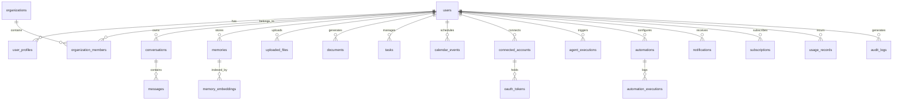

# Database Schema Specification
## TECHNOPIE AI — PostgreSQL & pgvector Schema

**Database Engine:** PostgreSQL 15+ / Supabase  
**Vector Extension:** `pgvector` (1536-dimensional embeddings for OpenAI `text-embedding-3-small` / Gemini embeddings)  
**Security Model:** Row-Level Security (RLS) enabled on all user-partitioned tables.

---

## 1. Schema Diagram (ERD Overview)



---

## 2. Table Definitions (PostgreSQL DDL)

```sql
-- Enable Extensions
CREATE EXTENSION IF NOT EXISTS "uuid-ossp";
CREATE EXTENSION IF NOT EXISTS "pgcrypto";
CREATE EXTENSION IF NOT EXISTS "vector";

-- ========================================================
-- 1. USERS & PROFILES
-- ========================================================
CREATE TABLE IF NOT EXISTS users (
    id UUID PRIMARY KEY DEFAULT uuid_generate_v4(),
    email VARCHAR(255) UNIQUE NOT NULL,
    hashed_password VARCHAR(255),
    is_active BOOLEAN DEFAULT TRUE NOT NULL,
    is_verified BOOLEAN DEFAULT FALSE NOT NULL,
    is_superuser BOOLEAN DEFAULT FALSE NOT NULL,
    created_at TIMESTAMPTZ DEFAULT NOW() NOT NULL,
    updated_at TIMESTAMPTZ DEFAULT NOW() NOT NULL
);

CREATE TABLE IF NOT EXISTS user_profiles (
    id UUID PRIMARY KEY DEFAULT uuid_generate_v4(),
    user_id UUID UNIQUE NOT NULL REFERENCES users(id) ON DELETE CASCADE,
    full_name VARCHAR(255) NOT NULL,
    preferred_name VARCHAR(100),
    profession VARCHAR(255),
    work_description TEXT,
    preferred_language VARCHAR(50) DEFAULT 'en',
    timezone VARCHAR(100) DEFAULT 'UTC',
    avatar_url TEXT,
    productivity_goals JSONB DEFAULT '[]'::jsonb,
    ai_tone_preference VARCHAR(50) DEFAULT 'executive', -- executive, casual, formal, concise
    auto_approval_level VARCHAR(20) DEFAULT 'level_2', -- level_1 (strict), level_2 (balanced), level_3 (autonomous)
    onboarding_completed BOOLEAN DEFAULT FALSE,
    created_at TIMESTAMPTZ DEFAULT NOW() NOT NULL,
    updated_at TIMESTAMPTZ DEFAULT NOW() NOT NULL
);

-- ========================================================
-- 2. ORGANIZATIONS & TEAMS
-- ========================================================
CREATE TABLE IF NOT EXISTS organizations (
    id UUID PRIMARY KEY DEFAULT uuid_generate_v4(),
    name VARCHAR(255) NOT NULL,
    slug VARCHAR(100) UNIQUE NOT NULL,
    created_by UUID REFERENCES users(id) ON DELETE SET NULL,
    created_at TIMESTAMPTZ DEFAULT NOW() NOT NULL,
    updated_at TIMESTAMPTZ DEFAULT NOW() NOT NULL
);

CREATE TABLE IF NOT EXISTS organization_members (
    id UUID PRIMARY KEY DEFAULT uuid_generate_v4(),
    organization_id UUID NOT NULL REFERENCES organizations(id) ON DELETE CASCADE,
    user_id UUID NOT NULL REFERENCES users(id) ON DELETE CASCADE,
    role VARCHAR(50) DEFAULT 'member' NOT NULL, -- owner, admin, member
    joined_at TIMESTAMPTZ DEFAULT NOW() NOT NULL,
    UNIQUE(organization_id, user_id)
);

-- ========================================================
-- 3. CONVERSATIONS & MESSAGING
-- ========================================================
CREATE TABLE IF NOT EXISTS conversations (
    id UUID PRIMARY KEY DEFAULT uuid_generate_v4(),
    user_id UUID NOT NULL REFERENCES users(id) ON DELETE CASCADE,
    title VARCHAR(255) DEFAULT 'New Conversation' NOT NULL,
    agent_type VARCHAR(100) DEFAULT 'general_assistant' NOT NULL,
    is_pinned BOOLEAN DEFAULT FALSE,
    is_archived BOOLEAN DEFAULT FALSE,
    context_summary TEXT,
    created_at TIMESTAMPTZ DEFAULT NOW() NOT NULL,
    updated_at TIMESTAMPTZ DEFAULT NOW() NOT NULL
);

CREATE TABLE IF NOT EXISTS messages (
    id UUID PRIMARY KEY DEFAULT uuid_generate_v4(),
    conversation_id UUID NOT NULL REFERENCES conversations(id) ON DELETE CASCADE,
    user_id UUID NOT NULL REFERENCES users(id) ON DELETE CASCADE,
    sender_role VARCHAR(20) NOT NULL, -- 'user', 'assistant', 'system', 'tool'
    content TEXT NOT NULL,
    model_provider VARCHAR(50), -- 'openai', 'gemini', 'anthropic', 'mock'
    model_name VARCHAR(100),
    tokens_used INTEGER DEFAULT 0,
    tool_calls JSONB DEFAULT '[]'::jsonb,
    tool_results JSONB DEFAULT '[]'::jsonb,
    action_items JSONB DEFAULT '[]'::jsonb,
    created_at TIMESTAMPTZ DEFAULT NOW() NOT NULL
);

-- ========================================================
-- 4. PERSONAL MEMORY & PGVECTOR EMBEDDINGS
-- ========================================================
CREATE TABLE IF NOT EXISTS memories (
    id UUID PRIMARY KEY DEFAULT uuid_generate_v4(),
    user_id UUID NOT NULL REFERENCES users(id) ON DELETE CASCADE,
    category VARCHAR(50) NOT NULL, -- personal, professional, preference, contact, goal, habit, decision
    content TEXT NOT NULL,
    importance_score FLOAT DEFAULT 1.0,
    confidence_score FLOAT DEFAULT 1.0,
    source_message_id UUID REFERENCES messages(id) ON DELETE SET NULL,
    is_active BOOLEAN DEFAULT TRUE NOT NULL,
    is_pinned BOOLEAN DEFAULT FALSE NOT NULL,
    created_at TIMESTAMPTZ DEFAULT NOW() NOT NULL,
    updated_at TIMESTAMPTZ DEFAULT NOW() NOT NULL
);

CREATE TABLE IF NOT EXISTS memory_embeddings (
    id UUID PRIMARY KEY DEFAULT uuid_generate_v4(),
    memory_id UUID UNIQUE NOT NULL REFERENCES memories(id) ON DELETE CASCADE,
    user_id UUID NOT NULL REFERENCES users(id) ON DELETE CASCADE,
    embedding vector(1536) NOT NULL, -- compatible with standard 1536-dim embeddings
    model_version VARCHAR(100) NOT NULL,
    created_at TIMESTAMPTZ DEFAULT NOW() NOT NULL
);

CREATE INDEX IF NOT EXISTS idx_memory_embeddings_vector 
ON memory_embeddings USING ivfflat (embedding vector_cosine_ops)
WITH (lists = 100);

-- ========================================================
-- 5. FILES & GENERATED DOCUMENTS
-- ========================================================
CREATE TABLE IF NOT EXISTS uploaded_files (
    id UUID PRIMARY KEY DEFAULT uuid_generate_v4(),
    user_id UUID NOT NULL REFERENCES users(id) ON DELETE CASCADE,
    original_filename VARCHAR(255) NOT NULL,
    stored_path TEXT NOT NULL,
    file_size_bytes BIGINT NOT NULL,
    mime_type VARCHAR(100) NOT NULL,
    extracted_text TEXT,
    embedding_status VARCHAR(50) DEFAULT 'pending',
    created_at TIMESTAMPTZ DEFAULT NOW() NOT NULL
);

CREATE TABLE IF NOT EXISTS documents (
    id UUID PRIMARY KEY DEFAULT uuid_generate_v4(),
    user_id UUID NOT NULL REFERENCES users(id) ON DELETE CASCADE,
    title VARCHAR(255) NOT NULL,
    doc_type VARCHAR(50) NOT NULL, -- 'docx', 'pdf', 'xlsx', 'pptx', 'csv', 'txt'
    file_path TEXT NOT NULL,
    file_size_bytes BIGINT NOT NULL,
    source_prompt TEXT,
    status VARCHAR(50) DEFAULT 'ready', -- generating, ready, failed
    metadata JSONB DEFAULT '{}'::jsonb,
    created_at TIMESTAMPTZ DEFAULT NOW() NOT NULL,
    updated_at TIMESTAMPTZ DEFAULT NOW() NOT NULL
);

-- ========================================================
-- 6. TASKS & PRIORITIES
-- ========================================================
CREATE TABLE IF NOT EXISTS tasks (
    id UUID PRIMARY KEY DEFAULT uuid_generate_v4(),
    user_id UUID NOT NULL REFERENCES users(id) ON DELETE CASCADE,
    title VARCHAR(255) NOT NULL,
    description TEXT,
    status VARCHAR(50) DEFAULT 'todo' NOT NULL, -- 'todo', 'in_progress', 'completed', 'cancelled'
    priority VARCHAR(50) DEFAULT 'medium' NOT NULL, -- 'low', 'medium', 'high', 'urgent'
    due_date TIMESTAMPTZ,
    reminder_at TIMESTAMPTZ,
    tags TEXT[] DEFAULT ARRAY[]::TEXT[],
    is_recurring BOOLEAN DEFAULT FALSE,
    recurrence_rule VARCHAR(100), -- daily, weekly, monthly, cron
    created_by_agent VARCHAR(100), -- e.g. 'Email Agent', 'Voice Assistant', 'User'
    created_at TIMESTAMPTZ DEFAULT NOW() NOT NULL,
    updated_at TIMESTAMPTZ DEFAULT NOW() NOT NULL
);

-- ========================================================
-- 7. CALENDAR EVENTS
-- ========================================================
CREATE TABLE IF NOT EXISTS calendar_events (
    id UUID PRIMARY KEY DEFAULT uuid_generate_v4(),
    user_id UUID NOT NULL REFERENCES users(id) ON DELETE CASCADE,
    external_event_id VARCHAR(255),
    provider VARCHAR(50) DEFAULT 'google', -- 'google', 'outlook', 'technopie'
    title VARCHAR(255) NOT NULL,
    description TEXT,
    start_time TIMESTAMPTZ NOT NULL,
    end_time TIMESTAMPTZ NOT NULL,
    timezone VARCHAR(100) NOT NULL DEFAULT 'UTC',
    location TEXT,
    attendees JSONB DEFAULT '[]'::jsonb,
    meeting_link TEXT,
    status VARCHAR(50) DEFAULT 'confirmed', -- confirmed, tentative, cancelled
    ai_agenda_summary TEXT,
    created_at TIMESTAMPTZ DEFAULT NOW() NOT NULL,
    updated_at TIMESTAMPTZ DEFAULT NOW() NOT NULL
);

-- ========================================================
-- 8. CONNECTED ACCOUNTS & OAUTH TOKENS
-- ========================================================
CREATE TABLE IF NOT EXISTS connected_accounts (
    id UUID PRIMARY KEY DEFAULT uuid_generate_v4(),
    user_id UUID NOT NULL REFERENCES users(id) ON DELETE CASCADE,
    provider VARCHAR(100) NOT NULL, -- 'google', 'microsoft', 'slack', 'notion'
    account_email VARCHAR(255) NOT NULL,
    scopes TEXT[] DEFAULT ARRAY[]::TEXT[],
    is_active BOOLEAN DEFAULT TRUE NOT NULL,
    last_synced_at TIMESTAMPTZ,
    created_at TIMESTAMPTZ DEFAULT NOW() NOT NULL,
    updated_at TIMESTAMPTZ DEFAULT NOW() NOT NULL,
    UNIQUE(user_id, provider, account_email)
);

CREATE TABLE IF NOT EXISTS oauth_tokens (
    id UUID PRIMARY KEY DEFAULT uuid_generate_v4(),
    connected_account_id UUID UNIQUE NOT NULL REFERENCES connected_accounts(id) ON DELETE CASCADE,
    encrypted_access_token TEXT NOT NULL,
    encrypted_refresh_token TEXT,
    token_type VARCHAR(50) DEFAULT 'Bearer',
    expires_at TIMESTAMPTZ,
    encryption_key_id VARCHAR(100) DEFAULT 'default_aes_gcm',
    updated_at TIMESTAMPTZ DEFAULT NOW() NOT NULL
);

-- ========================================================
-- 9. AGENTS & EXECUTIONS
-- ========================================================
CREATE TABLE IF NOT EXISTS agent_definitions (
    id UUID PRIMARY KEY DEFAULT uuid_generate_v4(),
    slug VARCHAR(100) UNIQUE NOT NULL,
    name VARCHAR(255) NOT NULL,
    description TEXT,
    default_provider VARCHAR(50) DEFAULT 'gemini',
    default_model VARCHAR(100) DEFAULT 'gemini-2.5-flash',
    system_prompt TEXT NOT NULL,
    available_tools JSONB DEFAULT '[]'::jsonb,
    is_active BOOLEAN DEFAULT TRUE NOT NULL
);

CREATE TABLE IF NOT EXISTS agent_executions (
    id UUID PRIMARY KEY DEFAULT uuid_generate_v4(),
    user_id UUID NOT NULL REFERENCES users(id) ON DELETE CASCADE,
    agent_slug VARCHAR(100) NOT NULL,
    conversation_id UUID REFERENCES conversations(id) ON DELETE SET NULL,
    autonomy_level VARCHAR(20) NOT NULL, -- 'level_1', 'level_2', 'level_3'
    input_payload JSONB NOT NULL,
    plan_steps JSONB DEFAULT '[]'::jsonb,
    execution_result JSONB,
    status VARCHAR(50) DEFAULT 'running', -- running, completed, waiting_approval, failed, cancelled
    requires_approval BOOLEAN DEFAULT FALSE,
    approved_by_user_at TIMESTAMPTZ,
    error_message TEXT,
    execution_time_ms INTEGER,
    created_at TIMESTAMPTZ DEFAULT NOW() NOT NULL
);

-- ========================================================
-- 10. AUTOMATIONS & SCHEDULED JOBS
-- ========================================================
CREATE TABLE IF NOT EXISTS automations (
    id UUID PRIMARY KEY DEFAULT uuid_generate_v4(),
    user_id UUID NOT NULL REFERENCES users(id) ON DELETE CASCADE,
    title VARCHAR(255) NOT NULL,
    description TEXT,
    trigger_type VARCHAR(100) NOT NULL, -- 'cron', 'email_received', 'task_created', 'webhook'
    trigger_config JSONB NOT NULL, -- e.g. {"cron": "0 8 * * *", "timezone": "Asia/Kolkata"}
    action_type VARCHAR(100) NOT NULL, -- 'daily_briefing', 'auto_summarize', 'meeting_prep'
    action_config JSONB NOT NULL,
    is_active BOOLEAN DEFAULT TRUE NOT NULL,
    last_run_at TIMESTAMPTZ,
    next_run_at TIMESTAMPTZ,
    created_at TIMESTAMPTZ DEFAULT NOW() NOT NULL,
    updated_at TIMESTAMPTZ DEFAULT NOW() NOT NULL
);

CREATE TABLE IF NOT EXISTS automation_executions (
    id UUID PRIMARY KEY DEFAULT uuid_generate_v4(),
    automation_id UUID NOT NULL REFERENCES automations(id) ON DELETE CASCADE,
    user_id UUID NOT NULL REFERENCES users(id) ON DELETE CASCADE,
    status VARCHAR(50) NOT NULL, -- success, failure, partial
    logs JSONB DEFAULT '[]'::jsonb,
    output_summary TEXT,
    error_message TEXT,
    duration_ms INTEGER,
    created_at TIMESTAMPTZ DEFAULT NOW() NOT NULL
);

-- ========================================================
-- 11. NOTIFICATIONS & ALERTS
-- ========================================================
CREATE TABLE IF NOT EXISTS notifications (
    id UUID PRIMARY KEY DEFAULT uuid_generate_v4(),
    user_id UUID NOT NULL REFERENCES users(id) ON DELETE CASCADE,
    title VARCHAR(255) NOT NULL,
    body TEXT NOT NULL,
    type VARCHAR(50) DEFAULT 'info', -- 'info', 'warning', 'action_required', 'success', 'meeting'
    is_read BOOLEAN DEFAULT FALSE NOT NULL,
    action_url TEXT,
    metadata JSONB DEFAULT '{}'::jsonb,
    created_at TIMESTAMPTZ DEFAULT NOW() NOT NULL
);

-- ========================================================
-- 12. SUBSCRIPTIONS, USAGE & AUDIT LOGS
-- ========================================================
CREATE TABLE IF NOT EXISTS subscriptions (
    id UUID PRIMARY KEY DEFAULT uuid_generate_v4(),
    user_id UUID UNIQUE NOT NULL REFERENCES users(id) ON DELETE CASCADE,
    plan_tier VARCHAR(50) DEFAULT 'free' NOT NULL, -- free, personal, professional, executive, business
    gateway VARCHAR(50), -- 'razorpay', 'stripe'
    gateway_subscription_id VARCHAR(255),
    status VARCHAR(50) DEFAULT 'active' NOT NULL, -- active, past_due, cancelled, trialing
    current_period_start TIMESTAMPTZ,
    current_period_end TIMESTAMPTZ,
    cancel_at_period_end BOOLEAN DEFAULT FALSE,
    created_at TIMESTAMPTZ DEFAULT NOW() NOT NULL,
    updated_at TIMESTAMPTZ DEFAULT NOW() NOT NULL
);

CREATE TABLE IF NOT EXISTS usage_records (
    id UUID PRIMARY KEY DEFAULT uuid_generate_v4(),
    user_id UUID NOT NULL REFERENCES users(id) ON DELETE CASCADE,
    metric_type VARCHAR(100) NOT NULL, -- 'ai_tokens', 'documents_generated', 'voice_seconds', 'searches'
    quantity INTEGER NOT NULL,
    model_provider VARCHAR(50),
    cost_usd NUMERIC(10, 6) DEFAULT 0.0,
    created_at TIMESTAMPTZ DEFAULT NOW() NOT NULL
);

CREATE TABLE IF NOT EXISTS audit_logs (
    id UUID PRIMARY KEY DEFAULT uuid_generate_v4(),
    user_id UUID REFERENCES users(id) ON DELETE SET NULL,
    action VARCHAR(255) NOT NULL, -- 'login', 'email_sent', 'calendar_event_created', 'memory_deleted'
    resource_type VARCHAR(100) NOT NULL,
    resource_id VARCHAR(255),
    ip_address VARCHAR(45),
    user_agent TEXT,
    details JSONB DEFAULT '{}'::jsonb,
    created_at TIMESTAMPTZ DEFAULT NOW() NOT NULL
);

-- ========================================================
-- INDEXES & PERFORMANCE OPTIMIZATION
-- ========================================================
CREATE INDEX IF NOT EXISTS idx_messages_conversation_id ON messages(conversation_id);
CREATE INDEX IF NOT EXISTS idx_tasks_user_status_due ON tasks(user_id, status, due_date);
CREATE INDEX IF NOT EXISTS idx_memories_user_category ON memories(user_id, category);
CREATE INDEX IF NOT EXISTS idx_notifications_user_unread ON notifications(user_id, is_read);
CREATE INDEX IF NOT EXISTS idx_audit_logs_user_action ON audit_logs(user_id, action);
```
