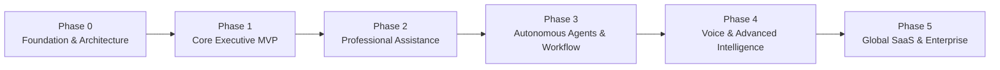

# Development Roadmap & Execution Strategy
## TECHNOPIE AI — Strategic Release Plan

**Roadmap Version:** 1.0  
**Current Phase:** Phase 0 (Foundation) ➔ Phase 1 (Core MVP)  

---

## 1. Phase-by-Phase Execution Framework

---

## 2. Phase Breakdown

### Phase 0: Product Foundation & Architecture (Current Milestone)
- [x] Analyze global product requirements and executive workflow paradigms.
- [x] Draft Comprehensive Product Requirements Document (`PRD.md`).
- [x] Design Enterprise Multi-Agent System Architecture (`ARCHITECTURE.md`).
- [x] Specify PostgreSQL + pgvector Database Schema (`DATABASE_SCHEMA.md`).
- [x] Establish Security and Prompt Injection Guardrails (`SECURITY.md`).
- [x] Document REST & SSE Streaming API contracts (`API_DOCUMENTATION.md`).
- [x] Establish Monorepo directory structure (`/frontend`, `/backend`, `/docs`).
- [x] Create comprehensive `.env.example`.

### Phase 1: Core Executive MVP (Immediate Priority)
- **Frontend Workspace:**
  - Modern Next.js 14+ App Router with React, TypeScript, Tailwind CSS, Lucide icons.
  - Sophisticated executive palette: Dark navy (`#070B14`, `#0F172A`), white typography, executive blue accents.
  - Responsive Left Sidebar with 12 distinct navigation workspaces.
  - Interactive Central Executive Workspace: greeting, quick priority metrics, upcoming schedule, and interactive AI chat.
  - Light / Dark theme switching.
- **Backend Core & AI Brain:**
  - Python FastAPI async REST API with auto-generated OpenAPI docs.
  - AI Model Provider Abstraction: unified interface for OpenAI, Google Gemini, Anthropic, and smart Mock/Fallback engine.
  - Conversation management with streaming SSE (Server-Sent Events) and persistent history.
  - Long-Term Personal Memory Engine: categorized storage, semantic retrieval, viewer, edit, and deletion endpoints.
  - Full Task Management Engine: CRUD, priority scoring, due dates, categories, status transitions, and natural language extraction.
- **Authentication & Onboarding:**
  - User registration, login, token refresh, and guest/demo mode.
  - Guided 8-step Executive Onboarding modal to collect working habits and seed initial memory.

### Phase 2: Professional Assistance & Productivity
- **Email Management (Gmail OAuth):**
  - Connect Gmail via Google OAuth 2.0 with minimal required scopes.
  - Email synchronization, thread categorization (Action Required, VIP, Newsletters).
  - Draft response generation with user tone matching.
  - Explicit approval gate: Level 3 execution requires manual user authorization before sending.
- **Calendar Management (Google Calendar):**
  - Two-way sync, event creation, conflict detection, and free/busy search.
  - Automated meeting agenda builder and daily schedule optimization.
- **Multi-Format Document Generation:**
  - Real downloadable generation of `.docx`, `.pdf`, `.xlsx`, `.csv`, `.pptx`.
  - Preview and direct download links.
- **Deep Research Assistant:**
  - Multi-source web search synthesis with epistemic labeling (Verified Fact vs. Estimate vs. Opinion).

### Phase 3: Autonomous Multi-Agent Orchestration
- **LangGraph-Style Agent Graph:**
  - Central Supervisor routing to specialized agents: Personal Productivity, Email, Calendar, Research, Document, Business Analysis, Task.
  - Autonomy levels enforcement (Level 1: Read, Level 2: Prepare/Draft, Level 3: Execute).
  - Execution audit trail and rollback capabilities.
- **Automation & Workflow Engine:**
  - Scheduled jobs (e.g. 8:00 AM Executive Briefing) and event-driven webhooks.
  - Visual automation rule builder and execution history.

### Phase 4: Voice Assistant & Advanced Intelligence
- **Voice System Phase 1:** Web Speech Audio recorder -> Whisper STT -> AI Brain execution -> Speech Synthesis TTS (English & Hindi support).
- **Voice System Phase 2:** Real-time bi-directional WebSocket audio streaming with VAD and barge-in capability.
- **Integrations Marketplace:** Expand to Microsoft 365 (Outlook, Teams), Slack, Notion, WhatsApp Business.

### Phase 5: Global SaaS, Billing & Enterprise Scale
- **Subscription & Billing Engine:**
  - Razorpay (domestic & international cards, UPI, netbanking) and Stripe integration.
  - Tiered plans: Free, Personal, Professional, Executive, Business.
- **Enterprise Admin Console:**
  - User and team management, real-time token telemetry, provider API cost metrics, and system diagnostics.
- **Cloud Deployment:**
  - Dockerized multi-stage containers, Vercel frontend deployment, cloud backend deployment with CI/CD.

---

## 3. Definition of Done (DoD) for Each Feature
1. **Type Safety & Linting:** Clean TypeScript and Python type annotations with zero lint errors.
2. **Deterministic Fallbacks:** The app runs out-of-the-box in local development with smart mock/demo fallbacks when third-party API credentials are not yet entered.
3. **No Fake Elements:** No non-functional buttons or fake downloads; all UI interactions link to active endpoints.
4. **Security Verified:** All mutations validate tenant ownership and enforce explicit approval boundaries on sensitive actions.
