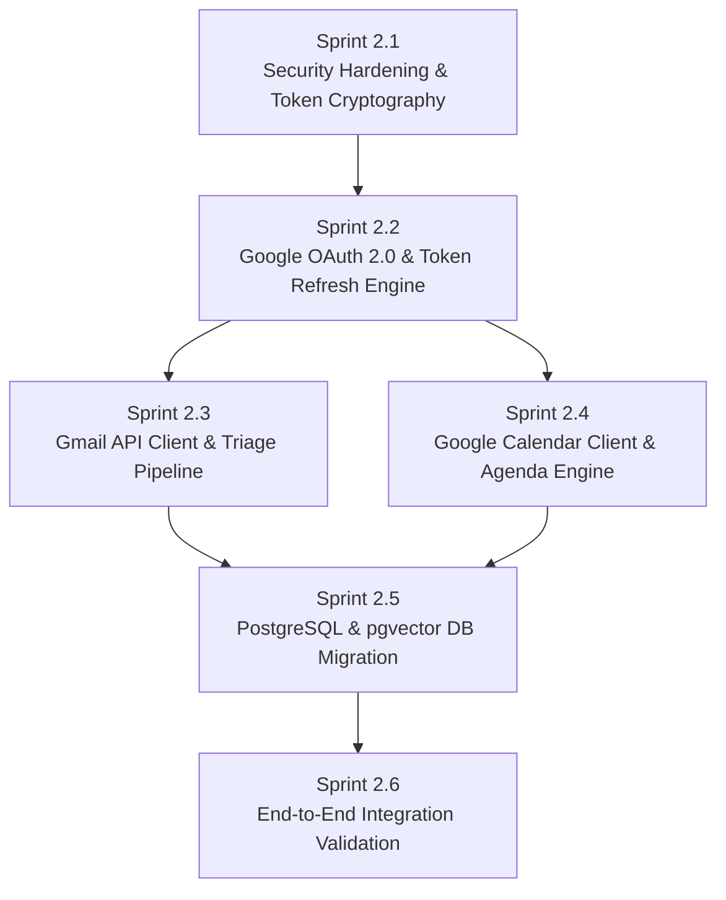

# Phase 2 Development Plan: Professional Assistance
## TECHNOPIE AI — Implementation Blueprint

**Milestone Target:** Phase 2 (Professional Assistance & External Integrations)  
**Prerequisites:** All Phase 1.5 critical and high security defects resolved.

---

## 1. Objectives & Scope of Phase 2

1. **Official Google Workspace OAuth 2.0:**
   - Implement authorization redirect URL generation.
   - Implement `/api/integrations/google/callback` code-for-token exchange.
   - Encrypt access and refresh tokens at rest with AES-256-GCM.
   - Implement automatic background token refresh when tokens expire.
2. **Real Gmail Executive Management:**
   - Read authorized inbox messages using `google-api-python-client`.
   - Categorize threads into *Action Required*, *VIP*, *Informational*, *Newsletter*.
   - Draft context-aware responses matching user's tone.
   - Enforce Level 3 approval card: sending external emails strictly requires manual user click.
3. **Google Calendar Two-Way Synchronization:**
   - Synchronize calendar events and identify conflicts in real time.
   - Propose open meeting slots.
   - Automated morning schedule briefing.
4. **PostgreSQL & pgvector Production Migration:**
   - Transition from SQLite to PostgreSQL + pgvector.
   - Configure Alembic for version-controlled database migrations.
   - Enable 1536-dimensional semantic memory search.
5. **Real AI Provider Activation:**
   - Populate `GOOGLE_API_KEY` for Google Gemini 2.5 Flash and Pro.

---

## 2. Sprint Breakdown & Milestones

---

## 3. Definition of Done for Phase 2
- [ ] Real Gmail inbox messages visible in Emails workspace.
- [ ] Sending an email actually delivers an email to recipient's inbox and appears in Gmail Sent folder.
- [ ] Creating an event in Technopie AI reflects immediately on Google Calendar mobile app and web UI.
- [ ] OAuth tokens are encrypted with AES-256-GCM in database.
- [ ] All API mutations enforce strict authentication and tenant ownership.
