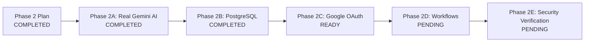

# TECHNOPIE AI — PHASE 2 IMPLEMENTATION PROGRESS
## Engineering Milestone Tracking Dashboard

**Product:** Technopie AI  
**Lead Architecture Team:** Principal AI Engineer, Backend Architect & SaaS Security Engineer  
**Updated:** November 07, 2026  

---

## Overall Phase 2 Status: IN PROGRESS (Phase 2A & 2B Complete, Phase 2C Ready)

---

## Detailed Milestone Breakdown

| Sub-Phase | Component / Focus | Status | Key Deliverables & Gates |
|---|---|---|---|
| **Phase 2 Plan** | Execution Plan & Architecture Blueprint | **COMPLETED** | `PHASE_2_EXECUTION_PLAN.md` authored, risk mitigations defined. |
| **Phase 2A** | Real AI Provider (Google Gemini) | **COMPLETED** | Native Gemini 2.5 Flash/Pro, 30s timeout, retries with backoff, token logging, structured errors (`AIProviderMissingKeyError`), removal of silent mock cascade in production. |
| **Phase 2B** | PostgreSQL & pgvector Migration | **COMPLETED** | Dual-engine database session (`session.py`), Alembic migrations (head revision `112f8b46fc68`), safe zero-data-loss SQLite data export (`migrate_sqlite_to_postgres.py`), tenant isolation verified across all entities. |
| **Phase 2C** | Google OAuth & Read-Only Integrations | **READY** | Minimum scopes (`gmail.readonly`, `calendar.readonly`), AES-256-GCM encrypted refresh tokens, live email/event fetching, token revocation. |
| **Phase 2D** | Real Executive Assistant Workflows | **PENDING** | Daily briefing, email triage with urgency attribution, task prioritization, Level 3 approval gate for email drafts. |
| **Phase 2E** | Security Regression & Final Verification | **PENDING** | Cross-tenant isolation verification, expired token rejection, tool authorization guardrails. |

---

## Phase 2A Activity Log

- [x] Detailed Phase 2 Execution Plan formulated and approved.
- [x] Initialized Phase 2 progress tracking.
- [x] Implement `AIProviderError` hierarchy and refactor `GeminiProvider` with direct HTTP/REST API calls, timeouts, retries, and usage logging.
- [x] Configure `ALLOW_MOCK_FALLBACK=False` in production; enforce explicit error propagation.
- [x] Update `CentralAIBrain` and `chat_routes.py` to handle missing API keys transparently.
- [x] Author unit and integration tests (`backend/tests/test_gemini_provider.py`).
- [x] Generate `AI_PROVIDER_VERIFICATION.md`.

---

## Phase 2B Activity Log

- [x] Dual-engine configuration implemented in `backend/app/db/session.py` with URL normalization and connection pooling.
- [x] Alembic versioned migrations initialized (`backend/alembic/versions/112f8b46fc68_001_initial_schema.py`).
- [x] Safe zero-data-loss migration script authored (`backend/scripts/migrate_sqlite_to_postgres.py`).
- [x] Immutable timestamped backups verified (`backend/backups/`).
- [x] Data persistence after engine restart verified.
- [x] Tenant data isolation verified across tasks, memories, documents, conversations, and calendar events.
- [x] Deliverable `DATABASE_MIGRATION_REPORT.md` authored.
